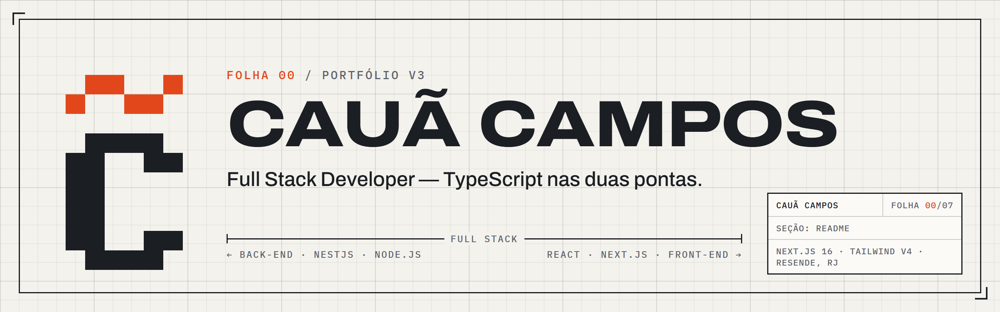
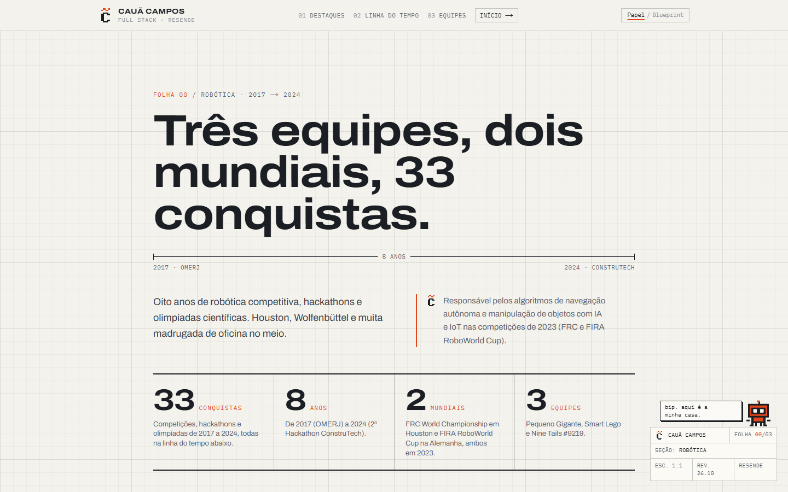
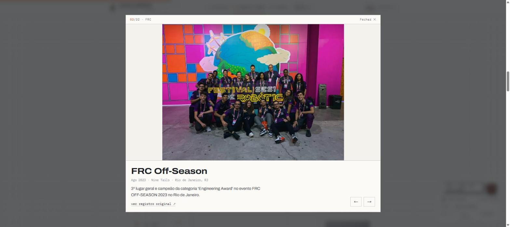

<div align="center">

<picture>
  <source media="(prefers-color-scheme: dark)" srcset=".github/assets/banner-blueprint.png">
  
</picture>

<br>

**Portfólio v3 de Cauã Campos** — desenvolvedor Full Stack em Resende, RJ.<br>
Um site pensado como um **caderno de engenharia**: papel milimetrado, plantas em blueprint, cotas, carimbo técnico e um robozinho pixel.

<br>


[LinkedIn](https://www.linkedin.com/in/caua-campos) · [GitHub](https://github.com/c4mpos-dev) · [campos.eet@gmail.com](mailto:campos.eet@gmail.com)

</div>

---

## Sumário

- [O conceito](#o-conceito)
- [Galeria](#galeria)
- [O que tem no site](#o-que-tem-no-site)
- [Movimento e interação](#movimento-e-interação)
- [Stack](#stack)
- [Estrutura do projeto](#estrutura-do-projeto)
- [Editando o conteúdo](#editando-o-conteúdo)
- [Rodando localmente](#rodando-localmente)
- [Decisões técnicas](#decisões-técnicas)
- [Acessibilidade e desempenho](#acessibilidade-e-desempenho)
- [Sistema visual](#sistema-visual)
- [Próximos passos](#próximos-passos)

---

## O conceito

A maioria dos portfólios de dev se parece: fundo preto, gradiente roxo, cards arredondados. Este parte de outra pergunta: **como seria o portfólio de alguém que passou oito anos em oficina de robótica antes de escrever software profissionalmente?**

A resposta virou uma linguagem visual de **desenho técnico**:

| Elemento | De onde vem |
|---|---|
| **Papel milimetrado**, **blueprint** e **grafite** | O caderno de projeto, a planta de engenharia e a prancheta à noite. A troca entre eles é uma varredura, como numa copiadora heliográfica. |
| **Folhas numeradas** (`FOLHA 01 / EXPERIÊNCIA`) | Cada seção é uma folha de um conjunto de desenhos. |
| **Cotas** `├──── ────┤` | As linhas de dimensão do desenho técnico, que se desenham sozinhas ao aparecer. |
| **Carimbo** no canto da tela | O quadro de identificação de uma planta: autor, folha atual, escala e revisão. Acompanha a seção que você está lendo. |
| **Laranja de segurança** como único destaque | Oficina, FRC e sinalização industrial. Usado só em marcas, nunca em superfícies. |
| **Logo em pixel** | Um **C** (Cauã Campos) sob o **til** de "Cauã", a letra que torna o nome único. Desenhada num grid de 6 × 10 para ficar nítida no favicon de 16px. |
| **Robozinho pixel** | O mascote, em pé sobre o carimbo, comentando a seção atual. Clique nele. |
| **Telemetria** | A atividade no GitHub lida como um sensor em campo. |

---

## Galeria

<table>
  <tr>
    <td width="50%"><br><sub><b>Folha 00 · Apresentação</b> — tema Papel, ficha técnica e cota back-end ↔ front-end.</sub></td>
    <td width="50%"><br><sub><b>Tema Blueprint</b> — a mesma folha em planta azul. O carimbo e o robô ficam no canto.</sub></td>
  </tr>
  <tr>
    <td><br><sub><b>Diagrama vivo</b> — a arquitetura da Next Devices, com pacotes de telemetria correndo pelas conexões.</sub></td>
    <td><br><sub><b>Projetos</b> — cada projeto com tipo, plataforma e o que dá para abrir (online, código aberto ou privado).</sub></td>
  </tr>
  <tr>
    <td><br><sub><b>Página do projeto</b> — ficha do projeto, destaques, stack e galeria.</sub></td>
    <td><br><sub><b>Telemetria</b> — commits por semana nos últimos 12 meses, atualizado uma vez por dia.</sub></td>
  </tr>
  <tr>
    <td><br><sub><b>Robótica</b> — três equipes, dois mundiais e a faixa de números que conta ao aparecer.</sub></td>
    <td><br><sub><b>Linha do tempo</b> — 32 registros de 2017 a 2024, com filtros e uma foto em cada.</sub></td>
  </tr>
  <tr>
    <td colspan="2" align="center"><br><sub><b>Visualizador</b> — foto ampliada, descrição, link para o registro original e navegação com ← →.</sub></td>
  </tr>
</table>

---

## O que tem no site

### `/` — Início

| Folha | Conteúdo |
|---|---|
| **00 · Apresentação** | Título, resumo profissional, links e uma **ficha técnica** em formato de tabela. |
| **01 · Experiência** | Next Devices, Oracclum e INATEL, cada uma com período, vínculo, local, contexto, atividades numeradas (`1.1`, `1.2`…) e stack completa. A Next Devices traz o **diagrama de arquitetura** dos três serviços. |
| **02 · Projetos** | Projetos em cards com prévia (captura de tela, documento tarjado para os sistemas de empresa ou um espaço reservado). Abre em **Destaques**; as abas separam Em empresas, Web e APIs, Mobile e Robótica. Cada card abre a página do projeto. |
| **03 · Telemetria** | Gráfico de commits por semana, com total, pico, média e último sinal, puxado do GitHub. |
| **04 · Competências** | Linguagens, tecnologias, práticas e idiomas. Sem barras de porcentagem. |
| **05 · Formação** | AEDB, INATEL e FIRJAN SENAI. |
| **06 · Sobre** | Texto pessoal, as fotos de viagem passando uma a uma e a trajetória em capítulos. |
| **07 · Contato** | Email, WhatsApp, LinkedIn e GitHub. |

### `/robotica` — Robótica

- Abertura com o papel nas competições de 2023 (algoritmos de navegação autônoma e manipulação com IA e IoT) e a **faixa de números**: 33 conquistas, 8 anos, 2 mundiais e 3 equipes, cada um com a explicação de onde vem.
- **Destaques**: o **mapa de rotas** de 2023 (Resende → Houston e Resende → Wolfenbüttel, traçado pela rolagem), FRC World Championship e FIRA RoboWorld Cup.
- **Linha do tempo**: os 32 registros com foto, filtráveis em Robótica, Hackathons, Olimpíadas e Outros. Clicar abre o visualizador.
- **Equipes**: as três equipes em lista, cada uma abrindo a sua folha em `/robotica/equipes`.

### `/robotica/equipes` — Equipes

As três equipes como três fases, da mais antiga à mais recente: um **cronograma** com os períodos na mesma escala de tempo e, para cada time, foto, ficha, prêmios em destaque e todos os registros dele (puxados da linha do tempo pelo campo `team`). No desktop, a ficha da equipe fica fixa enquanto os registros rolam.

### `/projetos/[slug]` — Página de cada projeto

Gerada estaticamente para cada item da lista. Mostra ficha (tipo, plataforma, acesso, onde, ano e papel), descrição, destaques, stack, galeria e navegação para o projeto anterior e o próximo. Projetos privados explicam por que não há link nem código público.

> **Idiomas:** o site inteiro existe em português (na raiz, `/robotica`) e em inglês (em `/en`, `/en/robotica`). O seletor PT / EN fica no topo, ao lado dos temas.
>
> O antigo `/info` redireciona para `/#sobre`. Endereços que não existem caem numa **folha 404** no mesmo estilo.

---

## Movimento e interação

Todo movimento tem uma função, e **com `prefers-reduced-motion` ativo o site fica estático e completo**.

| Onde | O que acontece |
|---|---|
| **Seções** | Elementos entram com fade e um leve deslocamento, escalonados entre irmãos. As cotas se desenham da esquerda para a direita e as figuras são "plotadas". |
| **Diagrama de arquitetura** | Caixas e conexões se montam ao entrar na tela. Pacotes laranja percorrem as setas o tempo todo (`<animateMotion>`). Passar o mouse numa caixa destaca só os fluxos dela, em CSS puro com `:has()`. |
| **Troca de tema** | Três temas (Papel, Blueprint e Grafite). Ir para a direita na lista revela o novo tema com uma varredura de cima para baixo, e voltar sobe, via **View Transitions API**. Sem suporte, a troca é instantânea. |
| **Fotos do Sobre** | As fotos passam sozinhas, a cada 3,4 s, como cópias saindo de uma copiadora heliográfica: uma linha laranja varre o quadro de cima para baixo, a foto nova aparece em tons de blueprint e revela as cores, depois desliza devagar. Os segmentos no topo marcam o tempo; pausa com o mouse em cima, com foco ou fora da tela. |
| **Projetos** | O nome do projeto "voa" da linha da lista para o título da página, com `<ViewTransition>` do React 19.3. |
| **Vista explodida da stack** | Em Competências, quatro placas isométricas (front-end, API, dados, infra) começam afastadas e se encaixam conforme a figura chega ao meio da tela. |
| **Mapa de rotas** | Em Robótica, a página para e a rolagem traça os dois trechos de 2023 sobre um mapa em matriz de pontos: os continentes surgem numa varredura a partir de Resende, uma mira de plotter corre sobre a rota em grande círculo, os quilômetros contam no painel e o destino pisca ao chegar. |
| **Fotos** | Cada foto desliza devagar dentro da própria moldura enquanto a página passa. |
| **Galeria do projeto** | Clicar numa captura abre o visualizador, com legenda e ← → entre as imagens; Esc ou um clique fora fecha. |
| **Régua lateral** | Em telas largas, uma régua na margem esquerda mapeia a página inteira: um traço por folha (clicável) e um marcador com a posição de leitura. |
| **Cronograma das equipes** | As barras dos períodos se desenham da esquerda para a direita. |
| **Telemetria** | Passar o mouse (ou usar ← →) no gráfico de commits move uma agulha sobre a escala e lê a semana e o total. |
| **Documento tarjado** | Nos projetos privados, a galeria mostra um documento "de uso interno": as tarjas riscam os campos uma a uma e o carimbo "confidencial" bate no final. |
| **Números da robótica** | Contam do zero até o valor quando aparecem. |
| **Linha do tempo** | O traço vertical se preenche conforme a rolagem. |
| **Carimbo e robô** | O carimbo mostra a folha e a seção atuais, e o robô troca de frase a cada seção. |
| **Barra de progresso** | Uma linha laranja de 2px no topo acompanha a leitura. |

---

## Stack

| Camada | Tecnologia |
|---|---|
| Framework | **Next.js 16** (App Router, Cache Components, Partial Prefetching) |
| UI | **React 19.3** com `<ViewTransition>` |
| Linguagem | **TypeScript 5** |
| Estilo | **Tailwind CSS v4**, com tokens em CSS custom properties e `@utility` próprios |
| Tipografia | **Archivo** (eixo de largura, usado expandido nos títulos) e **IBM Plex Mono**, via `next/font` |
| Imagens | `next/image` com otimização automática |
| Ícones do app | `icon.svg` e `apple-icon` gerado com `ImageResponse` (`next/og`) |
| Dados externos | API pública de contribuições do GitHub, com `"use cache"` e `cacheLife("days")` |
| Qualidade | ESLint (`eslint-config-next`) e TypeScript estrito |

Não há biblioteca de animação: tudo é CSS, SVG e alguns `IntersectionObserver`.

---

## Estrutura do projeto

```text
src/
├── proxy.ts                    # português na raiz, inglês em /en (reescreve para app/[lang])
├── i18n/                       # idiomas: tr(), caminhos por idioma e o contexto do idioma atual
├── app/
│   ├── [lang]/layout.tsx       # fontes, tema, idioma, topbar, carimbo e efeitos globais
│   ├── [lang]/page.tsx         # início: as folhas 00 a 07
│   ├── globals.css             # tokens Papel/Blueprint, utilitários e animações
│   ├── icon.svg                # favicon (logo pixel em bloco escuro)
│   ├── apple-icon.tsx          # ícone da tela inicial, gerado a partir do mapa de pixels
│   ├── projetos/[slug]/        # página do projeto e a galeria com visualizador
│   └── robotica/
│       ├── page.tsx
│       ├── achievement-log.tsx # linha do tempo com filtros e visualizador
│       ├── route-chart.tsx     # mapa de rotas de 2023, cena fixa traçada pela rolagem
│       ├── route-map-data.ts   # máscara de terra do mapa (Natural Earth 1:110m)
│       ├── equipes/page.tsx    # as três equipes, com cronograma e registros
│       └── stat-counters.tsx   # faixa de números com contagem
├── components/
│   ├── logo.tsx                # mapa de pixels da marca, LogoMark e LogoLockup
│   ├── pixel-robot.tsx         # o mascote
│   ├── title-block.tsx         # carimbo do canto e falas do robô
│   ├── topbar.tsx              # navegação com a folha ativa e menu no celular
│   ├── arch-diagram.tsx        # diagrama vivo da Next Devices
│   ├── stack-exploded.tsx      # vista explodida da stack, montada pela rolagem
│   ├── scroll-ruler.tsx        # régua lateral com a posição na página
│   ├── telemetry.tsx           # gráfico de commits (server component com cache)
│   ├── signal-chart.tsx        # barras do gráfico com a agulha de leitura
│   ├── redacted.tsx            # documento tarjado dos projetos privados
│   ├── project-list.tsx        # cards de projetos com prévia e abas por área
│   ├── scroll-fx.tsx           # revelação no scroll, progresso (--p) das peças animadas e FxReady
│   ├── theme-toggle.tsx        # Papel / Blueprint / Grafite com varredura, e o seletor PT / EN
│   ├── photo-reel.tsx          # fotos de viagem passando no Sobre
│   └── ui.tsx                  # Section, Dimension, Figure, Chips, Footer…
└── content/                    # todo o texto do site, separado do layout
    ├── site.ts                 # links sociais e navegação por página
    ├── work.ts                 # experiências, competências e formação
    ├── projects.ts             # projetos, tipos, plataformas e acesso
    ├── achievements.ts         # os 32 registros de competições
    ├── robotica.ts             # números, destaques e equipes
    └── info.ts                 # sobre, capítulos e canais de contato

public/
├── brand/                      # logo em SVG para usar fora do site
└── images/conquistas/          # fotos das competições
```

---

## Editando o conteúdo

O texto fica todo em `src/content/`. Para mudar o site, quase nunca é preciso mexer nos componentes.

### Adicionar um projeto

Em `src/content/projects.ts`, cada projeto é classificado em **três eixos independentes**, para caber também o que não é um site:

| Eixo | Valores |
|---|---|
| `kind`: o que é | `produto` · `sistema-interno` · `cliente` · `desafio-tecnico` · `estudo` · `pessoal` · `hackathon` |
| `platforms`: onde roda | `web` · `mobile` · `api` · `iot` · `desktop` |
| `access`: o que dá para abrir | `online` · `codigo-aberto` · `privado` · `em-breve` |
| `areas`: abas onde aparece | `empresa` · `web` · `mobile` · `robotica` (e `featured: true` para Destaques) |

```ts
{
  slug: "meu-projeto",                 // vira /projetos/meu-projeto
  name: "Meu Projeto",
  kind: "produto",
  platforms: ["web", "api"],
  access: "online",
  areas: ["web"],                     // abas onde o card aparece
  featured: true,                     // opcional: entra em Destaques
  summary: "Uma linha para o card.",
  year: "2026",
  role: "Full Stack",
  about: ["Parágrafo da página do projeto."],
  highlights: ["Destaque numerado."],
  stack: ["Next.js", "NestJS", "PostgreSQL"],
  links: { live: "https://…", repo: "https://github.com/…" },
  shots: [{ src: "/images/projetos/meu-projeto/home.jpg", caption: "Tela inicial" }],
}
```

A página do projeto é gerada sozinha. Imagens sem `src` aparecem como "foto pendente".

### Adicionar uma conquista

Coloque a foto em `public/images/conquistas/` e acrescente um item em `src/content/achievements.ts`. Os filtros, a contagem por categoria e o visualizador se ajustam sozinhos.

### Trocar a logo

A marca é um mapa de pixels em `src/components/logo.tsx` (`LOGO_PIXELS`). O favicon, o ícone da Apple e os arquivos de `public/brand/` usam o mesmo desenho.

### Ajustar cores

Os tokens dos três temas estão no topo de `src/app/globals.css`, em `:root` (Papel), `[data-theme="dark"]` (Blueprint) e `[data-theme="graphite"]` (Grafite).

### Traduzir ou editar o inglês

O português continua nos arquivos de `src/content/`. O inglês fica ao lado, no fim de cada arquivo (ou em `projects-en.ts`), como trechos que substituem só os campos de texto. Textos de interface ficam no próprio componente, com `tr(lang, "português", "english")`.

### Fotos do Sobre

Coloque as fotos em `public/images/sobre/` e preencha `src` em `travelPhotos`, em `src/content/info.ts`. Sem `src`, a foto aparece como um quadro reservado com o nome do lugar.

---

## Rodando localmente

Requer Node.js recente (desenvolvido com Node 24) e npm.

```bash
git clone https://github.com/c4mpos-dev/portfolio_v3.git
cd portfolio_v3
npm install
npm run dev        # http://localhost:3000
```

| Script | O que faz |
|---|---|
| `npm run dev` | Servidor de desenvolvimento com Turbopack |
| `npm run build` | Build de produção (todas as páginas são geradas estaticamente) |
| `npm run start` | Serve a build de produção |
| `npm run lint` | ESLint |

> **Aviso de hydration no console em dev?** Se aparecerem atributos como `bis_skin_checked`, é uma extensão do navegador alterando o HTML antes de o React carregar. Abra em uma janela anônima para conferir: o site em si não gera o aviso.

---

## Decisões técnicas

Alguns problemas que apareceram no caminho e como foram resolvidos:

- **Efeitos sem `MutationObserver`.** A primeira versão observava o `<body>` inteiro para achar elementos novos. Em desenvolvimento, isso entrava em ciclo com as ferramentas do Next e com extensões do navegador. Agora a varredura é explícita: na troca de rota e quando um componente avisa (`requestRevealScan`).
- **Esperar a hydration.** Os efeitos ficam no layout, que hidrata antes da página. Para não alterar elementos que o React ainda não assumiu, um componente `FxReady` no rodapé de cada página sinaliza quando ela terminou de hidratar.
- **Seguro com React Strict Mode.** A lista de elementos já observados fica na memória de cada montagem, e não marcada no DOM. Assim, a montagem dupla do Strict Mode não deixa conteúdo invisível.
- **Itens de grid que encolhem.** `:where(.grid) > * { min-width: 0 }` impede que um diagrama ou tabela larga alargue a página no celular. Eles rolam dentro da própria caixa.
- **Cores em SVG.** Atributos de apresentação (`fill="…"`) não aceitam `var()` de forma confiável, então as cores dos SVGs vão em `style`, e o diagrama e a logo acompanham o tema.
- **View Transitions com escopo.** A animação customizada da troca de tema só vale enquanto `[data-scan]` está presente, para não desligar as transições entre páginas.
- **Animação guiada pela rolagem sem biblioteca.** Qualquer elemento com `data-scrub` recebe a variável `--p` (0 → 1) conforme atravessa a tela, e o CSS deriva dela o que precisar (`calc`, `clamp`, `offset-distance`). As páginas continuam sendo server components. Com `data-scrub="pin"`, o progresso corre enquanto um filho `sticky` fica preso na tela (o mapa de rotas).
- **Telemetria com cache.** O gráfico do GitHub é um server component com `"use cache"` e `cacheLife("days")`. A página continua estática e se revalida uma vez por dia.
- **Logo em pixels inteiros.** O mapa de 6 × 10 é centralizado num bloco de 16 unidades, para que no favicon de 16px cada pixel da marca caia num pixel da tela.

---

## Acessibilidade e desempenho

- **Movimento reduzido** respeitado em tudo: animações desligadas e conteúdo visível desde o início, com as peças guiadas pela rolagem já no estado final.
- **Sem JavaScript** o conteúdo também aparece inteiro (`<noscript>` desliga os estados iniciais das animações).
- **Foco visível** com contorno tracejado na cor de destaque. Filtros, navegação e visualizador funcionam pelo teclado (o visualizador usa `<dialog>`, com ← → e Esc).
- **Semântica:** `nav`, `section`, `dl`, `figure` / `figcaption`, `aria-current` na navegação, `role="tablist"` nos filtros e textos alternativos no diagrama e nas fotos.
- **Tema sem flash:** um script inline no `<head>` aplica o tema salvo antes da primeira pintura.
- **Geração estática** de todas as rotas, `next/font` sem layout shift e `next/image` com tamanhos responsivos.

---

## Sistema visual

| Token | Papel | Blueprint | Grafite |
|---|---|---|---|
| Fundo | `#F3F2EC` | `#0D2140` | `#18191B` |
| Folha | `#FBFAF6` | `#10284B` | `#1F2023` |
| Tinta | `#1B1E23` | `#E8EEF8` | `#E9E7E1` |
| Destaque | `#E2471B` | `#FF6A3D` | `#F6743F` |

- **Grid de fundo:** quadrados de 24px, com linhas mais fortes a cada 120px.
- **Títulos:** Archivo 700 com largura de 118%.
- **Rótulos e dados:** IBM Plex Mono, em caixa alta com espaçamento.
- **Formas:** cantos retos, bordas finas no lugar de sombras e marcas de registro nos cantos das figuras.

---

## SEO e prévia de links

- Cada página tem título, descrição, URL canônica e versões PT/EN (`hreflang`), em `src/i18n/seo.ts`.
- **Prévia ao colar o link** (WhatsApp, LinkedIn, X): cada página gera a sua imagem 1200 × 630 no estilo do site — folha, título e dados da página —, em PT e em EN. O desenho fica em `src/app/_og/card.tsx`; cada rota tem o seu `opengraph-image.tsx`.
- `sitemap.xml` e `robots.txt` são gerados (`src/app/sitemap.ts` e `src/app/robots.ts`).
- O endereço público é `https://www.cauacampos.dev` (o domínio sem `www` redireciona). Para outro domínio, defina `NEXT_PUBLIC_SITE_URL`.
- Endereços do site anterior continuam funcionando: `/achievements` → `/robotica#linha-do-tempo`, `/teams` → `/robotica/equipes` e `/cv-caua.pdf` (que agora leva ao currículo atual, `/cv_CauaCampos.pdf`).

## Deploy (Vercel)

Não precisa de `vercel.json`: o Next é detectado sozinho e o build é `npm run build`.

1. Na Vercel, **Add New → Project** e importe este repositório. Deixe tudo no padrão e faça o deploy.
2. Confira o site no endereço `*.vercel.app` que a Vercel gerar.
3. Para trocar o domínio sem esperar propagação (o DNS já aponta para a Vercel):
   - no projeto novo, **Settings → Domains → Add** `www.cauacampos.dev` e `cauacampos.dev`. A Vercel avisa que o domínio está em outro projeto e oferece movê-lo; confirme;
   - ou, antes, remova os dois domínios do projeto antigo (**Settings → Domains → Remove**) e adicione no novo.
   - Deixe `www.cauacampos.dev` como principal e `cauacampos.dev` redirecionando para ele, como hoje.
4. O WhatsApp guarda a prévia antiga por um tempo. Para atualizar na hora, cole o link no [Sharing Debugger da Meta](https://developers.facebook.com/tools/debug/) e clique em **Scrape Again**.

---

## Próximos passos

- [ ] Fotos dos projetos (os espaços já existem como "foto pendente").
- [ ] Deploy na Vercel e troca do domínio (passo a passo acima).

---

<div align="center">


<sub>Desenhado e construído por Cauã Campos · Resende, RJ · 2026</sub><br>
<sub>Textos, fotos e marca © Cauã Campos.</sub>

</div>
