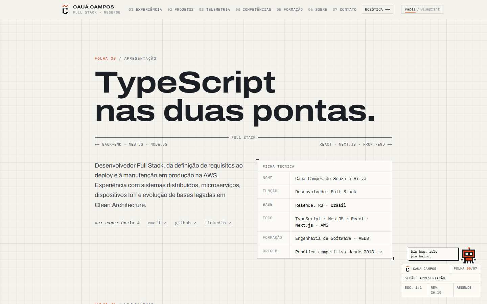
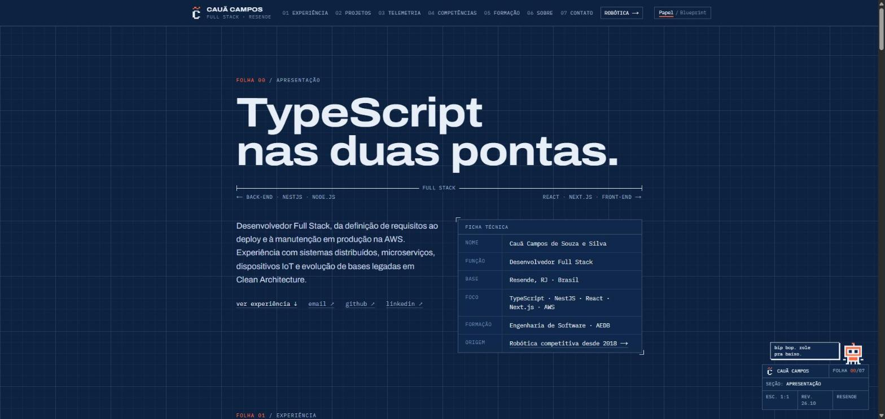
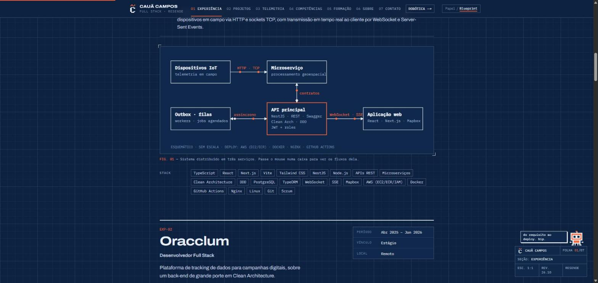
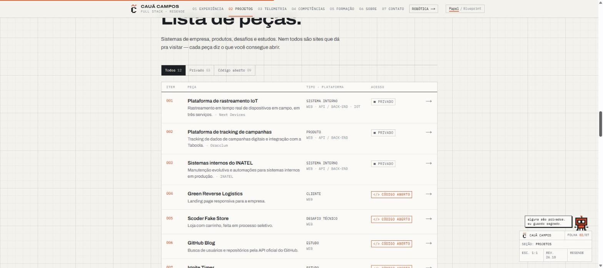
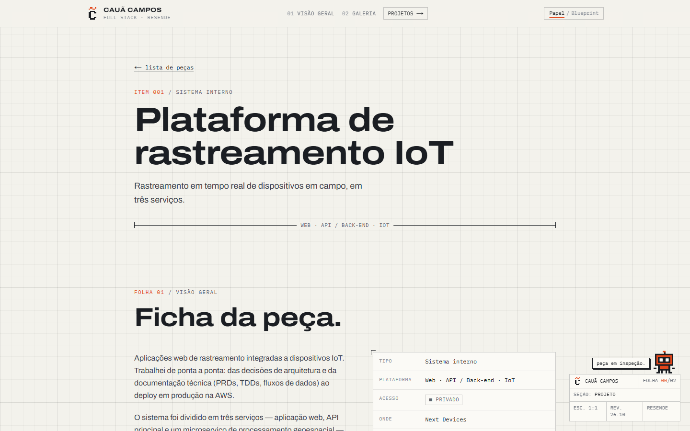
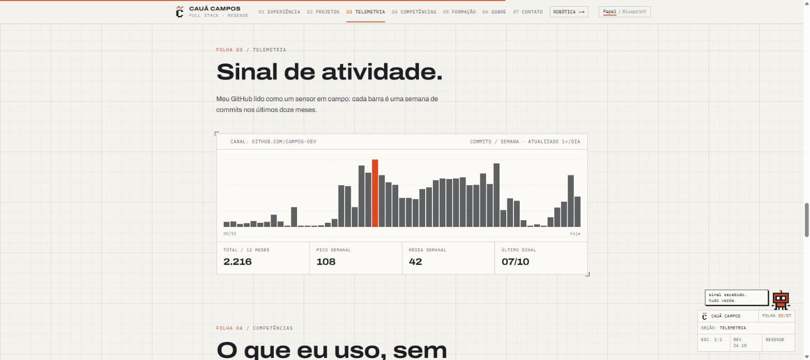
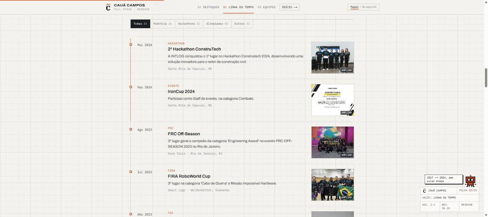

<div align="center">

<picture>
  <source media="(prefers-color-scheme: dark)" srcset=".github/assets/banner-blueprint.png">
  
</picture>

<br>

**Portfólio de Cauã Campos**, desenvolvedor Full Stack em Resende, RJ.<br>
Um site desenhado como um **caderno de engenharia**: papel milimetrado, plantas em blueprint, cotas e carimbo técnico.

<br>


**[cauacampos.dev](https://www.cauacampos.dev)** · [LinkedIn](https://www.linkedin.com/in/caua-campos) · [GitHub](https://github.com/c4mpos-dev) · [campos.eet@gmail.com](mailto:campos.eet@gmail.com)

</div>

---

## O conceito

A maioria dos portfólios de dev se parece: fundo preto, gradiente roxo, cards arredondados. Este parte de outra pergunta: **como seria o portfólio de alguém que aprendeu a programar numa oficina de robótica?**

A resposta virou uma linguagem visual de **desenho técnico**:

| Elemento | De onde vem |
|---|---|
| **Papel**, **Blueprint** e **Grafite** | O caderno de projeto, a planta de engenharia e a prancheta à noite. A troca de tema é uma varredura, como numa copiadora heliográfica. |
| **Folhas numeradas** | Cada seção é uma folha de um conjunto de desenhos. |
| **Cotas** `├──── ────┤` | As linhas de dimensão do desenho técnico, que se desenham ao aparecer. |
| **Carimbo** no canto da tela | O quadro de identificação de uma planta: autor, folha atual, escala e revisão. |
| **Laranja de segurança** | Oficina, FRC e sinalização industrial. É a única cor de destaque, usada só em marcas. |
| **Logo em pixel** | Um **C** sob o **til** de "Cauã", a letra que torna o nome único. |

---

## Galeria

<table>
  <tr>
    <td width="50%"><br><sub><b>Apresentação</b>: tema Papel, ficha técnica e cota back-end ↔ front-end.</sub></td>
    <td width="50%"><br><sub><b>Tema Blueprint</b>: a mesma folha em planta azul, com o carimbo no canto.</sub></td>
  </tr>
  <tr>
    <td><br><sub><b>Diagrama vivo</b>: a arquitetura de um sistema IoT, com pacotes de telemetria correndo pelas conexões.</sub></td>
    <td><br><sub><b>Projetos</b>: tipo, plataforma e o que dá para abrir (online, código aberto ou privado).</sub></td>
  </tr>
  <tr>
    <td><br><sub><b>Página do projeto</b>: ficha, destaques, stack e galeria.</sub></td>
    <td><br><sub><b>Telemetria</b>: commits por semana nos últimos 12 meses.</sub></td>
  </tr>
  <tr>
    <td><br><sub><b>Robótica</b>: três equipes e dois mundiais em 2023.</sub></td>
    <td><br><sub><b>Linha do tempo</b>: cada competição com foto e o registro original.</sub></td>
  </tr>
</table>

---

## O que tem no site

- **Início:** experiência, projetos, atividade no GitHub, competências, formação, um pouco sobre mim e contato.
- **Projetos:** uma página para cada um, com ficha, destaques, stack e capturas de tela.
- **Robótica:** as competições de 2018 a 2024, com o mapa das viagens aos dois mundiais de 2023 (Houston e Wolfenbüttel) e uma página para cada equipe.
- **Competições:** hackathons e olimpíadas, fora da robótica.

O site inteiro existe em **português** e em **inglês**, com seletor PT / EN no topo.

## Detalhes

- **Diagrama vivo:** a arquitetura de um sistema distribuído se monta ao aparecer, e passar o mouse numa caixa destaca só os fluxos dela.
- **Vista explodida da stack:** quatro camadas (front-end, API, dados, infra) se encaixam conforme você rola.
- **Mapa de rotas:** a rolagem traça as viagens de 2023 em grande círculo, com os quilômetros contando no painel.
- **Telemetria:** o gráfico de commits do GitHub lido como um sensor em campo, com uma agulha que mostra cada semana.
- **Projetos privados:** no lugar das telas, um documento tarjado com o carimbo "confidencial".
- **Transição entre páginas:** o nome do projeto sai do card e vira o título da página.

Tudo isso é feito com CSS e SVG, sem biblioteca de animação. Com movimento reduzido ativado no sistema, o site aparece parado e completo.

---

## Feito com

**Next.js 16**, **React 19**, **TypeScript** e **Tailwind CSS v4**. Tipografia em **Archivo** e **IBM Plex Mono**. Hospedado na **Vercel**.

| Token | Papel | Blueprint | Grafite |
|---|---|---|---|
| Fundo | `#F3F2EC` | `#0D2140` | `#18191B` |
| Tinta | `#1B1E23` | `#E8EEF8` | `#E9E7E1` |
| Destaque | `#E2471B` | `#FF6A3D` | `#F6743F` |

## Rodando localmente

```bash
git clone https://github.com/c4mpos-dev/portfolio_v3.git
cd portfolio_v3
npm install
npm run dev
```

---

<div align="center">


<sub>Feito à mão por Cauã Campos · Resende, RJ · 2026</sub><br>
<sub>Textos, fotos e marca © Cauã Campos.</sub>

</div>
